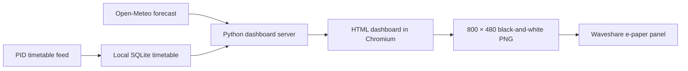

# Holešovice, at a glance

A self-contained dashboard for a Raspberry Pi Zero 2 W and an 800 × 480 black-and-white Waveshare e-paper panel. It brings together the time, weather for Holešovice, and scheduled trams from both platforms at Ortenovo náměstí. Once installed, the Pi fetches the data, renders the dashboard, and updates the panel every minute.

## Dashboard views

Choose the physical display at `/display.html` on the Pi's port 8787.

| View | What it shows | Direct preview |
| --- | --- | --- |
| Little Adventure | A tram-ticket layout with a seasonal greeting, forecast, and upcoming trams in both directions. | `/?design=station&display=1` |
| Daylight Mountain | An illustrated climb that follows the daylight hours, with a large clock, whole-degree temperatures, and two tram columns. | `/worlds.html?view=mountain&display=1` |

The main page also offers a weather poster and a weather character. The gallery at `/worlds.html` shows Mountain alongside four other illustrated worlds. Its weather studies let you preview rain, snow, wind, and day or night scenes. The physical screen uses live data.

Mountain changes its artwork using local sunrise, sunset, and current conditions. The climber follows the trail during daylight and camps at the day's finishing point after sunset. Shorter days produce shorter climbs. Each headline is selected from the phrases eligible for its season and time of day, then held until the next change at **06:00, 12:00, or 18:00 Europe/Prague**. Little Adventure uses the original 100 phrases. Mountain uses those plus 100 mountain phrases. [Original phrases](PHRASES.md) · [Mountain phrases](MOUNTAIN_PHRASES.md)

## How it works



| Component | Responsibility |
| --- | --- |
| `server.py`, `dashboard.py` | Serve the dashboard and JSON API. Cache weather for ten minutes and assemble a current snapshot. |
| `scripts/sync_transit.py` | Import tram service for platforms A (`U521Z1P`) and B (`U521Z2P`) from the PID feed. The server checks for a refresh every hour and fetches again once the import is six hours old. |
| `greetings.py`, `public/*phrases.json` | Select stable seasonal headlines and keep the evening phrase until morning. |
| `world.py`, `public/worlds/` | Maintain fictional scene details and draw the illustrated dashboards. |
| `scripts/render.mjs` | Wait for the HTML, fonts, and artwork, then export an image with only black and white pixels. |
| `display_settings.py`, `hardware/refresh.py` | Save the selected view, validate each new frame, and prevent overlapping panel updates. |
| `hardware/show_image.py`, `vendor/waveshare_epd/` | Transfer the bitmap over SPI with the pinned `epd7in5_V2` driver and put the panel to sleep after the update. |

Weather comes from model estimates for the stop's location. The precipitation figure is the highest remaining hourly probability today. Tram times are scheduled and include calendar exceptions and overnight service. The view shows upcoming departures within two hours, with up to four per platform in the API. [Open-Meteo documentation](https://open-meteo.com/en/docs) · [PID open data](https://pid.cz/o-systemu/opendata/)

## Run on a computer

With Python 3.9 or newer, import the timetable and start the server. The HTML and API run with the Python standard library. The first feed download may take a few minutes.

```bash
python3 scripts/sync_transit.py
python3 server.py
```

Open [the local dashboard](http://127.0.0.1:8787) or [the illustrated gallery](http://127.0.0.1:8787/worlds.html). To export a panel image, keep the server running and use Node.js with Chrome or Chromium installed.

```bash
npm ci
npm run render -- --design=mountain
```

The default export is `previews/mountain.png`. Use `CHROME_PATH` to point to a specific browser executable. The included PNG artwork, fonts, and icons are served locally. [Asset provenance](public/assets/backgrounds/README.md)

## Install and operate on the Pi

The tested hardware is a Pi Zero 2 W running Raspberry Pi OS Lite 32-bit (Trixie) with a 7.5-inch Waveshare V2 monochrome panel and a Rev2.3 HAT. On that HAT, the tested switch settings are **B** (0.47 Ω) and **0** (4-line SPI). Power off before connecting the HAT or ribbon.

Put the checkout at `/home/maks/eink-dashboard` and run the installer as `maks`. For a different account or path, update the installer and service units accordingly.

```bash
cd /home/maks/eink-dashboard
bash deploy/install-on-pi.sh
```

The installer enables SPI, installs Chromium and GPIO dependencies, and sets up systemd. `eink-dashboard.service` serves port 8787. `eink-refresh.timer` starts `eink-refresh.service` at each minute boundary and after boot. Each full panel update briefly flashes the screen. Use the chooser over your private LAN or Tailscale. The server has no authentication.

| Task | Command or path |
| --- | --- |
| Inspect the server and timer | `systemctl status eink-dashboard.service eink-refresh.timer` |
| Review the latest panel update | `journalctl -u eink-refresh.service -n 50 --no-pager` |
| Refresh the panel now | `sudo systemctl start eink-refresh.service` |
| Render without accessing GPIO | `python3 hardware/refresh.py --render-only` |
| See the saved choice and last display status | `/display.html` or `GET /api/display/settings` |
| Retrieve the last successful panel image | `GET /display.png` |

The worker leaves the previous image on the panel if rendering fails. A same-day cached forecast is marked as stale if weather cannot refresh. If the transit feed expires, the dashboard reports the unavailable timetable. Check `data/display-status.json` for the last attempt and success timestamps.

## Repository and checks

The checkout includes the dashboard code, artwork, local fonts, pinned driver, deployment scripts, and tests. Runtime state lives in `data/`, while the latest display frames and snapshots live in `images/`. These directories hold the saved display choice and fictional world history. Back up those settings before moving to a fresh Pi. Device provisioning files, dependencies, and generated previews are local to the installation.

Run `npm test` or `python3 -m unittest discover -s tests -v` with Pillow installed. The suite checks timetable handling, weather formatting, seasonal greeting rotation, display selection, and refresh failures. With the server and Chrome running, use `npm run check:browser` for the original views and `DASHBOARD_URL=http://127.0.0.1:8787 npm run check:worlds` for the illustrated gallery. [Detailed setup and checks](README.md)
